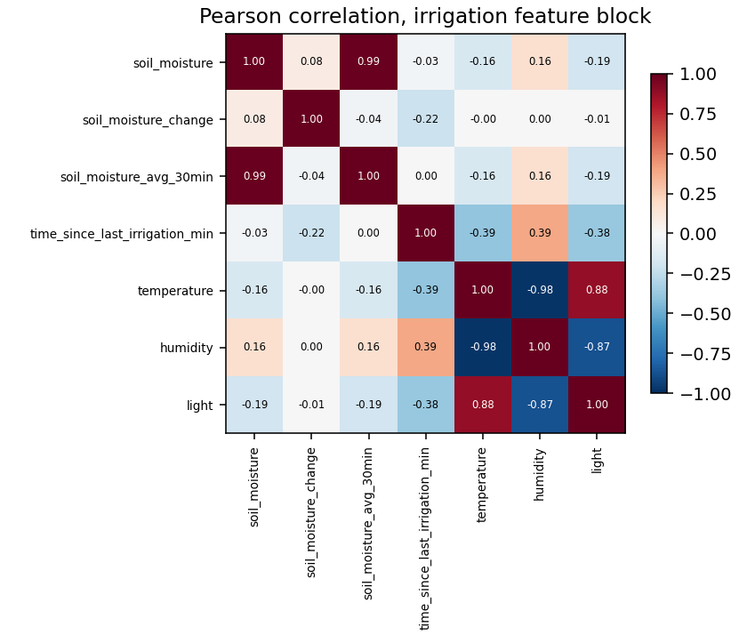
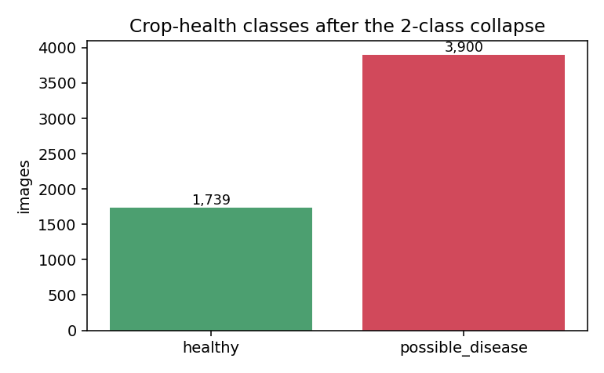

# Exploratory data analysis

Generated by `scripts/eda.py`. Do not edit by hand - the numbers here are copied from `models/eda_summary.json`, which the same run wrote. Re-run the script to regenerate.

## 1. Irrigation dataset

- Rows after cleaning: **12,960** (from 12,960 raw; 0 dropped, 0 values clipped)
- Columns: 17, model features: 7
- Positive rate (irrigation events): **0.0856**

### 1.1 Correlation of each feature with the target

Point-biserial correlation, which is Pearson against a 0/1 label. Sorted by absolute strength.

| feature | r | p | |r| rank |
| ------- | - | - | --------- |
| `soil_moisture_change` | -0.2566 | 6.95e-194 | 1 |
| `light` | +0.2205 | 1.68e-142 | 2 |
| `temperature` | +0.1868 | 4.75e-102 | 3 |
| `humidity` | -0.1866 | 6.44e-102 | 4 |
| `soil_moisture` | -0.1353 | 5.21e-54 | 5 |
| `soil_moisture_avg_30min` | -0.0984 | 3.1e-29 | 6 |
| `time_since_last_irrigation_min` | +0.0699 | 1.64e-15 | 7 |

Tested at alpha = 0.05. A p-value this small means the association is precisely measured, not that it is agronomically important - read the effect size in the same table.

### 1.2 Correlation within the feature block

Pairwise Pearson r over the 7 numeric features. Pairs above |0.8| are the ones a linear model handles least well:

| pair | r |
| ---- | - |
| `soil_moisture` / `soil_moisture_avg_30min` | +0.9918 |
| `temperature` / `humidity` | -0.9807 |
| `temperature` / `light` | +0.8751 |
| `humidity` / `light` | -0.8730 |

### 1.3 Cross-validation (TimeSeriesSplit(n_splits=5) on the 10-feature pipeline)

random or stratified folds place later readings in training and earlier ones in validation, which the model never faces at inference; TimeSeriesSplit preserves chronology.

Caveat: consecutive folds share a boundary day, so fold scores are correlated and the reported spread understates true variance.

| fold | n test | pos. rate | accuracy | balanced acc. | precision | recall | F1 |
| ---- | ------- | --------- | -------- | ------------ | --------- | ------ | -- |
| 1 | 2,160 | 0.0861 | 0.9421 | 0.7054 | 0.8211 | 0.4194 | 0.5552 |
| 2 | 2,160 | 0.0856 | 0.9407 | 0.7177 | 0.7615 | 0.4486 | 0.5646 |
| 3 | 2,160 | 0.0852 | 0.9407 | 0.7138 | 0.7642 | 0.4402 | 0.5586 |
| 4 | 2,160 | 0.0856 | 0.9440 | 0.7269 | 0.7963 | 0.4649 | 0.5870 |
| 5 | 2,160 | 0.0856 | 0.9444 | 0.7296 | 0.7982 | 0.4703 | 0.5918 |

| metric | mean | std | min | max |
| ------ | ---- | --- | --- | --- |
| accuracy | 0.9424 | 0.0018 | 0.9407 | 0.9444 |
| balanced_accuracy | 0.7187 | 0.0098 | 0.7054 | 0.7296 |
| precision | 0.7882 | 0.0252 | 0.7615 | 0.8211 |
| recall | 0.4487 | 0.0204 | 0.4194 | 0.4703 |
| f1 | 0.5715 | 0.0168 | 0.5552 | 0.5918 |

The single held-out split in `docs/model_results_and_tests.md` is one draw from this distribution. Quote the mean and the range together; a lone best-fold number overstates what the model does.

### 1.4 Hypothesis tests

**soil moisture is lower when an irrigation is scheduled** - Mann-Whitney U (one-sided, less)

- p = 1.01e-160 (significant at alpha = 0.05: True)
- effect size (rank-biserial) = +0.4893
- median soil moisture: 22.85 with an event (n=1,109) vs 33.70 without (n=11,851)
- why not a t-test: unequal group sizes and differently shaped moisture distributions; a t-test would assume normality neither group satisfies

**irrigation frequency differs between crops** - chi-square test of independence

- p = 0.0697 (significant at alpha = 0.05: False)
- chi-square = 5.33, dof = 2
- smallest expected count = 369.67 (above the 5 expected-count rule)

## 2. Crop-health dataset

- Images: **5,639** across 2 classes and 38 original PlantVillage classes
- `possible_disease`: 3,900 (0.6916)
- `healthy`: 1,739 (0.3084)
- Duplicate groups: 5,629; largest group 2 image(s); **0 group(s) span two splits** (clean)

### 2.1 Confidence intervals on the held-out test split

percentile bootstrap over per-image outcomes, 10000 resamples, seed 0, over 846 test images.

What this does not cover: resampling one test set does not capture the variance from a different training draw; that needs k-fold retraining, available via --crop-cv-folds.

| metric | point | 95% CI |
| ------ | ----- | ------ |
| accuracy | 0.9657 | 0.9527 - 0.9775 |
| balanced_accuracy | 0.9668 | 0.9532 - 0.9788 |
| f1_macro | 0.9606 | 0.9458 - 0.9738 |
| precision_healthy | 0.9242 | 0.8917 - 0.9534 |
| recall_healthy | 0.9697 | 0.9474 - 0.9885 |
| precision_possible_disease | 0.9859 | 0.9754 - 0.9947 |
| recall_possible_disease | 0.9639 | 0.9482 - 0.9782 |

### 2.2 Split balance

Chi-square on category x split: chi-square = 0.26, dof = 2, p = 0.88.

A non-significant result is the desired outcome: it means the train/val/test split did not systematically change the class mix, which is what the duplicate-group split was there to prevent

## 3. Outlier scan (irrigation features)

Two independent rules, because they disagree and the disagreement is informative. IQR is a distribution rule; |z| > 3 assumes normality, which clipped sensor series are not. **Nothing is deleted here** - `preprocess.py` owns cleaning and works on physical bounds.

| feature | min | median | max | IQR fences | below | above | abs z > 3 | skew |
| ------- | --- | ------ | --- | ---------- | ----- | ----- | ---------- | ---- |
| `soil_moisture` | 13.76 | 33.31 | 77.31 | -23.49 .. 110.11 | 0 | 0 | 0 | +0.61 |
| `soil_moisture_change` | -8.61 | -0.43 | 9.88 | -7.14 .. 6.78 | 15 | 188 | 27 | +0.54 |
| `soil_moisture_avg_30min` | 16.88 | 33.19 | 75.01 | -23.98 .. 110.61 | 0 | 0 | 0 | +0.62 |
| `time_since_last_irrigation_min` | 0.00 | 40.00 | 1440.00 | -165.00 .. 275.00 | 0 | 42 | 42 | +8.28 |
| `temperature` | 12.65 | 23.99 | 35.22 | -1.24 .. 49.24 | 0 | 0 | 0 | -0.01 |
| `humidity` | 38.49 | 68.09 | 97.05 | 6.79 .. 129.31 | 0 | 0 | 0 | -0.00 |
| `light` | 0.00 | 3653.00 | 84562.10 | -72135.90 .. 120226.50 | 0 | 0 | 0 | +0.86 |

A row outside an IQR fence is not necessarily an error: a sensor spike and a genuine irrigation event both look extreme. Read these against `reason` strings from the live API before treating any of them as bad data.

## 4. Figures

